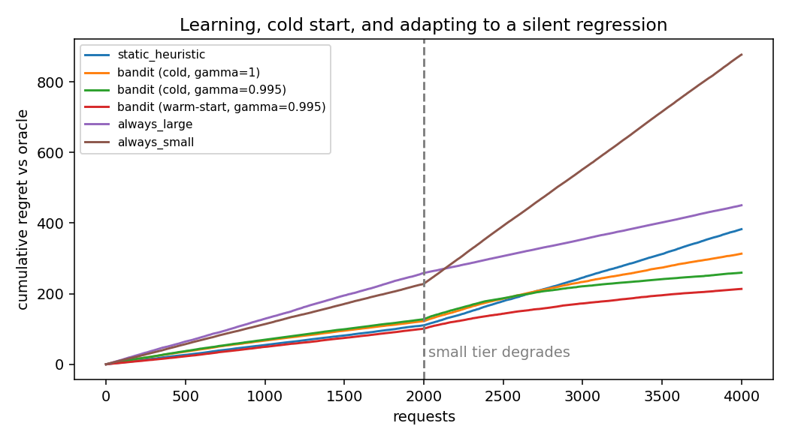

# RouteLearn: a self-improving LLM gateway

Most "smart routers" are hand-written rules: *short prompt → cheap model, long prompt → big model*.
They are tuned once and never notice when reality changes, for example when a provider silently
updates a model and your cheap tier gets worse.

**RouteLearn treats routing as an online learning problem.** A contextual bandit (discounted LinUCB)
learns, from sampled LLM-judge scores and optional user feedback, *which tier is good enough for which
kind of prompt*, and keeps adapting. A single dial (`lambda`) trades cost against quality at runtime.

```
prompt ─► features ─► bandit: q̂(tier | prompt) ± uncertainty ─► pick argmax[ q̂ + α·σ − λ·cost ]
                                   ▲                                         │
                                   │ update                                  ▼
         judge (sampled, cheap) ◄──┴── optional cascade ◄── call model ◄── answer
         + delayed user feedback (/feedback)
```

## What makes it different
| Idea | Why it matters |
|---|---|
| **Learns from feedback**, not hand-set thresholds | Adapts to *your* traffic and *your* quality bar |
| **Cost is known, quality is learned** | `lambda` can be changed live with no retraining |
| **Discounted updates** (`gamma<1`) | Re-routes when a model silently regresses |
| **Explainable routing** (`/explain`) | Per-tier estimated quality ± uncertainty for any prompt |
| **Sampled judging** | ~10% judge rate keeps most of the benefit at a fraction of the judge cost |
| **Honest evaluation harness** | Simulator, regret vs. oracle, ablations, Pareto frontier, multi-seed |

## Results (simulation; reproduce with `make experiments`)
Setup: 4,000 requests, 5 seeds, 3 tiers, `lambda=0.6`. At request 2,000 the **small tier silently degrades**.
Cost is relative to always-large and *includes* judge calls and amortised warm-start. Regret is measured
against an oracle that knows every tier's true quality.

| policy | quality | cost | cum. regret | post-degradation quality | post-degradation regret |
|---|---|---|---|---|---|
| always_large | 0.898 | 1.02x | 450 | 0.897 | 192 |
| always_medium | 0.703 | 0.62x | 299 | 0.701 | 118 |
| static heuristic | 0.685 | 0.63x | 383 | 0.630 | 272 |
| **bandit (cold, γ=0.995)** | 0.707 | 0.61x | **260** | **0.740** | **132** |
| **bandit (warm-start, γ=0.995)** | 0.734 | 0.69x | **214** | **0.746** | **113** |
| oracle | 0.834 | 0.71x | 0 | 0.855 | 0 |



**What the numbers say, including the unflattering parts**
- After the regression, the static heuristic keeps sending easy prompts to the broken tier. Its
  post-degradation regret is **272 vs 113–132** for the learners (roughly **half**), and quality is about 0.11 higher.
- Forgetting matters: with `gamma=1` the learner recovers more slowly (cum. regret 313 vs 260).
- **In a stationary setting the learner does *not* beat a well-tuned static heuristic**: see the
  frontier below, where the static curve sits slightly above. The learner pays ~0.09x of
  always-large for judging and warm-start (≈0.07x + ≈0.02x). What you buy with that is
  robustness to change and no hand-tuning, not free savings.
- `always_medium` is a strong baseline in this simulator (reward 0.328 vs 0.340 for the cold bandit).
- The cascade (escalate when the judge scores low) raises quality 0.74→0.81 at 0.70x→0.88x cost, which is
  about the same trade as lowering `lambda`. It is a safety net, not a free lunch.
- A 10% judge rate performs nearly as well as 30% at lower cost; 3% starts to hurt adaptation.


Full tables: [`results/summary.md`](results/summary.md), raw data: `results/results.json`.

> **Caveat.** These results come from a *simulator* I wrote (latent difficulty, sigmoid capability curves,
> noisy judge). They validate the algorithm and the evaluation machinery, not real-world savings.
> See "Validate on real data" below.

## Quickstart
```bash
pip install -r requirements.txt
python -m unittest discover -s tests -v # UTs
python examples/demo.py

python experiments/run_experiments.py  # regenerates results/ (about 1 minute)
python -m uvicorn routelearn.server:app --reload
make serve         # API (mock models unless ANTHROPIC_API_KEY is set)
```
```bash
curl -X POST localhost:8000/chat     -H 'content-type: application/json' -d '{"prompt":"What is TCP?"}'
curl -X POST localhost:8000/feedback -H 'content-type: application/json' -d '{"request_id":"<id>","score":0.2}'
curl -X POST localhost:8000/config   -H 'content-type: application/json' -d '{"lam":1.0}'   # go cheaper, live
curl -X POST localhost:8000/explain  -H 'content-type: application/json' -d '{"prompt":"Design a ..."}'
curl localhost:8000/stats
```

## Project layout
```
routelearn/  config.py (tiers, cost)  features.py  bandit.py (discounted LinUCB)  policies.py
             gateway.py (route→call→judge→learn→cascade)  providers.py  warmstart.py  workload.py  server.py
experiments/ run_experiments.py   examples/ demo.py   tests/   results/   docs/DESIGN.md
```

## Validate on real data (the next step; ~2-3 hours)
1. Collect 300-500 prompts (e.g. a mix of public chat/QA/coding sets).
2. Run **every** tier on each, judge with a stronger model, store `(prompt, tier, score, cost)`.
3. Replay the log offline through each policy (counterfactual evaluation, no further API spend) and add the
   real frontier to `results/`.
4. Compare to the simulator's conclusions and report where they differ.

## Known limitations
- Simulator results only; real-world gains unmeasured.
- `server.py` and the Anthropic provider/judge are written but were **not executed** in my environment
  (no network, no FastAPI/anthropic installed). Everything else is covered by tests and experiments.
- Prices in `config.py` are placeholders. Model names should be checked against the provider's current list.
- Linear model on hand-built features; no embeddings. Judge bias/noise is simulated, not measured.
