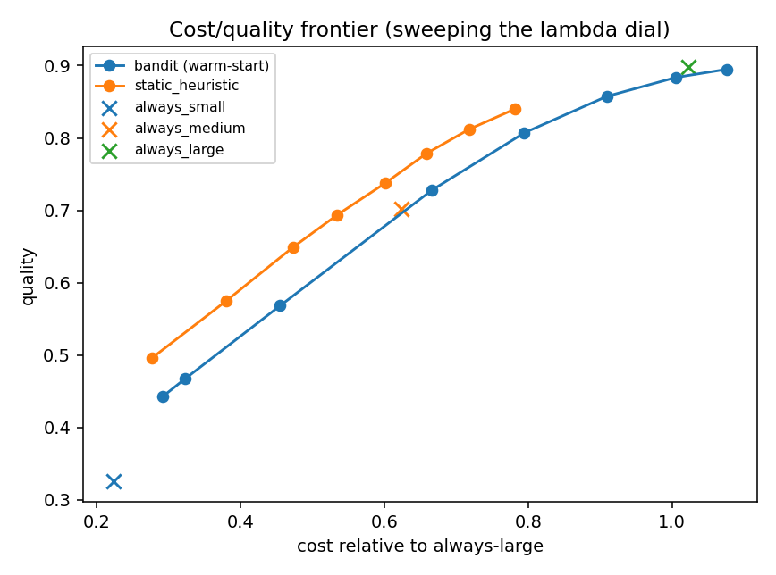

# RouteLearn: a self-improving LLM gateway

Most "smart routers" are hand-written rules: *short prompt → cheap model, long prompt → big model*.
They are tuned once and never notice when reality changes, for example when a provider silently
updates a model and your cheap tier gets worse.

**RouteLearn treats routing as an online learning problem.** A contextual bandit (discounted LinUCB)
learns, from sampled LLM-judge scores and optional user feedback, *which tier is good enough for which
kind of prompt*, and keeps adapting. A single dial (`lambda`) trades cost against quality at runtime.

```
prompt ─► features ─► bandit: q̂(tier | prompt) ± uncertainty ─► pick argmax[ q̂ + α·σ − λ·cost ]
                                   ▲                                         │
                                   │ update                                  ▼
         judge (sampled, cheap) ◄──┴── optional cascade ◄── call model ◄── answer
         + delayed user feedback (/feedback)
```

## What makes it different
| Idea | Why it matters |
|---|---|
| **Learns from feedback**, not hand-set thresholds | Adapts to *your* traffic and *your* quality bar |
| **Cost is known, quality is learned** | `lambda` can be changed live with no retraining |
| **Discounted updates** (`gamma<1`) | Re-routes when a model silently regresses |
| **Explainable routing** (`/explain`) | Per-tier estimated quality ± uncertainty for any prompt |
| **Sampled judging** | ~10% judge rate keeps most of the benefit at a fraction of the judge cost |
| **Honest evaluation harness** | Simulator, regret vs. oracle, ablations, Pareto frontier, multi-seed |

## Results (simulation; reproduce with `make experiments`)
Setup: 4,000 requests, 5 seeds, 3 tiers, `lambda=0.6`. At request 2,000 the **small tier silently degrades**.
Cost is relative to always-large and *includes* judge calls and amortised warm-start. Regret is measured
against an oracle that knows every tier's true quality.

| policy | quality | cost | cum. regret | post-degradation quality | post-degradation regret |
|---|---|---|---|---|---|
| always_small | 0.326 | 0.03x | 647 | 0.206 | 518 |
| always_medium | 0.703 | 0.50x | 250 | 0.701 | 77 |
| always_large | 0.898 | 1.00x | 641 | 0.897 | 271 |
| static heuristic | 0.685 | 0.52x | 356 | 0.630 | 244 |
| bandit (cold, γ=1) | 0.629 | 0.40x | 308 | 0.626 | 199 |
| **bandit (cold, γ=0.995)** | 0.619 | 0.38x | **289** | 0.627 | 181 |
| **bandit (warm-start, γ=0.995)** | 0.643 | 0.43x | **237** | **0.667** | **139** |
| oracle | 0.794 | 0.55x | 0 | 0.822 | 0 |


**What the numbers say, including the unflattering parts**
- After the regression, the static heuristic keeps sending easy prompts to the broken tier. Its
  post-degradation regret is **244 vs 139** for the warm-started bandit (43% lower); quality is
  0.667 vs 0.630.
- Forgetting helps in this run: `gamma=0.995` has lower cumulative regret than `gamma=1`
  (289 vs 308), though the cold band's average quality is slightly lower (0.619 vs 0.629).
- **In a stationary setting the learner does *not* beat a well-tuned static heuristic**: the
  static frontier reaches higher quality at comparable costs. This supports treating online learning
  as a drift-adaptation feature, not a guaranteed savings claim.
- `always_medium` is a strong baseline in this simulator (reward 0.401 vs 0.394 for the cold bandit).
- The cascade raises quality from 0.643 to 0.791 at 0.43x to 0.69x cost (`tau=0.5`), and to 0.846
  at 0.84x cost (`tau=0.7`). It is a safety net, not a free lunch.
- A 10% judge rate performs about as well as 30% in this run (quality 0.650 vs 0.643); 3% reduces
  adaptation quality to 0.618.



Full tables: [`results/summary.md`](results/summary.md), raw data: `results/results.json`.

> **Caveat.** These results come from a *simulator* I wrote (latent difficulty, sigmoid capability curves,
> noisy judge). They validate the algorithm and the evaluation machinery, not real-world savings.
> See "Validate on real data" below.

## Quickstart
```bash
pip install -r requirements.txt
python -m unittest discover -s tests -v # UTs
python examples/demo.py

python experiments/run_experiments.py  # regenerates results/ (about 1 minute)
python -m uvicorn routelearn.server:app --reload
make serve         # API (mock models unless ANTHROPIC_API_KEY is set)
```
```bash
curl -X POST localhost:8000/chat     -H 'content-type: application/json' -d '{"prompt":"What is TCP?"}'
curl -X POST localhost:8000/feedback -H 'content-type: application/json' -d '{"request_id":"<id>","score":0.2}'
curl -X POST localhost:8000/config   -H 'content-type: application/json' -d '{"lam":1.0}'   # go cheaper, live
curl -X POST localhost:8000/explain  -H 'content-type: application/json' -d '{"prompt":"Design a ..."}'
curl localhost:8000/stats
```

## Runtime API, state, and limits

`POST /chat` accepts optional conversation history, using `user` and `assistant` roles:

```json
{
  "prompt": "ok, do it",
  "history": [
    {"role": "user", "content": "Analyze the architecture and compare the trade-offs."},
    {"role": "assistant", "content": "Here is the comparison..."}
  ]
}
```

Only the latest four user turns are included in routing features; the provider receives the supplied
history (up to 20 messages and 20,000 total characters). `POST /chat/stream` returns server-sent
events (`data: {"type":"delta","text":"..."}` followed by a `type: done` event with request metadata).
When cascading is enabled, candidate text is buffered until the judge accepts an answer so rejected
attempts are not sent as user-visible output.

For deterministic tier testing, set `ROUTELEARN_ALLOW_TIER_OVERRIDE=true` before starting the
server. Then `/chat`, `/chat/stream`, and `/explain` accept `"force_tier": "medium"` or
`"force_tier": "large"` (`large` is the high tier). The override is disabled by default and returns
HTTP 403 if requested while disabled. Forced calls still use the configured provider and count
toward its usage, so use mock mode unless you intend to make billable Anthropic requests.

The server stores bandit updates, feedback references, and quota usage in SQLite
(`ROUTELEARN_DATABASE`, default `routelearn.sqlite3`), shared by workers on the same host. An
existing `state.npz` initializes the database only when it has no saved bandit state. Use a networked
database/service for workers on different hosts; SQLite is not a distributed database.

Default guardrails are **60 requests/minute and $10/day per identity**. Set
`ROUTELEARN_RATE_LIMIT_PER_MINUTE=0` or `ROUTELEARN_DAILY_SPEND_LIMIT=0` to disable the respective
limit. With no `ROUTELEARN_API_KEYS`, all requests share one quota bucket. Set a comma-separated
`ROUTELEARN_API_KEYS` list and send the matching `X-API-Key` header to enable separate per-key
buckets and require keys on the API endpoints. API keys are compared as secrets and stored only as
SHA-256 identities. The spend guard reserves a conservative token-cost estimate before calling a
provider and settles against reported token usage afterward; provider-side discounts, cache rates,
or billing adjustments are not reflected.

Model IDs and base prices in `config.py` are from Anthropic's [model overview](https://platform.claude.com/docs/en/models/overview)
and [API pricing](https://platform.claude.com/docs/en/about-claude/pricing), checked November 17,
2026: Haiku 5.5 ($0.10/$0.50), Sonnet 5.5 ($2/$10), and Opus 5.5 ($4/$20) per million input/output
tokens. Prices can change, so verify them before deployment.

## Project layout
```
routelearn/  config.py (tiers, cost)  features.py  bandit.py (discounted LinUCB)  policies.py
             gateway.py (route→call→judge→learn→cascade)  providers.py  warmstart.py  workload.py  server.py
experiments/ run_experiments.py   examples/ demo.py   tests/   results/   docs/DESIGN.md
```

## Validate on real data (the next step; ~2-3 hours)
1. Collect 300-500 prompts (e.g. a mix of public chat/QA/coding sets).
2. Run **every** tier on each, judge with a stronger model, store `(prompt, tier, score, cost)`.
3. Replay the log offline through each policy (counterfactual evaluation, no further API spend) and add the
   real frontier to `results/`.
4. Compare to the simulator's conclusions and report where they differ.

## Known limitations
- The experiment results remain simulator-only; the real-data replay harness has not been run on a
  real dataset, so real-world routing gains are unmeasured.
- HTTP routes, Anthropic request construction, judge parsing, and streaming are covered by tests using
  mocked SDK responses. No live provider request is made by the test suite; configure an API key and
  run a controlled smoke test before production.
- Anthropic is the only implemented provider. OpenAI, Gemini, and local providers, semantic
  embeddings, human-label judge calibration, real-latency penalties, drift alert delivery, and
  real-data replay remain future work.
- SQLite shares bandit learning state across workers on one host. Multi-host shared state needs an
  external database/service.
- The judge is not calibrated against human labels; monitor judge bias and quality with human audits.
